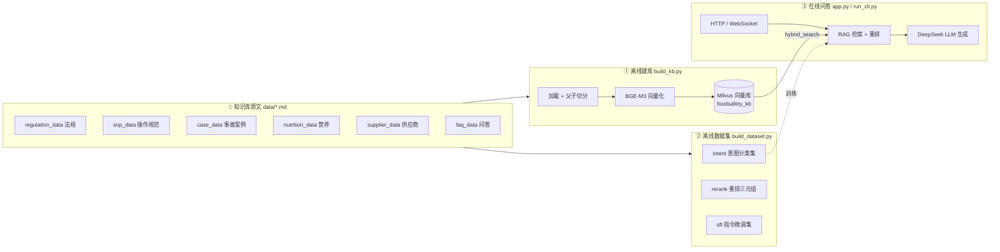
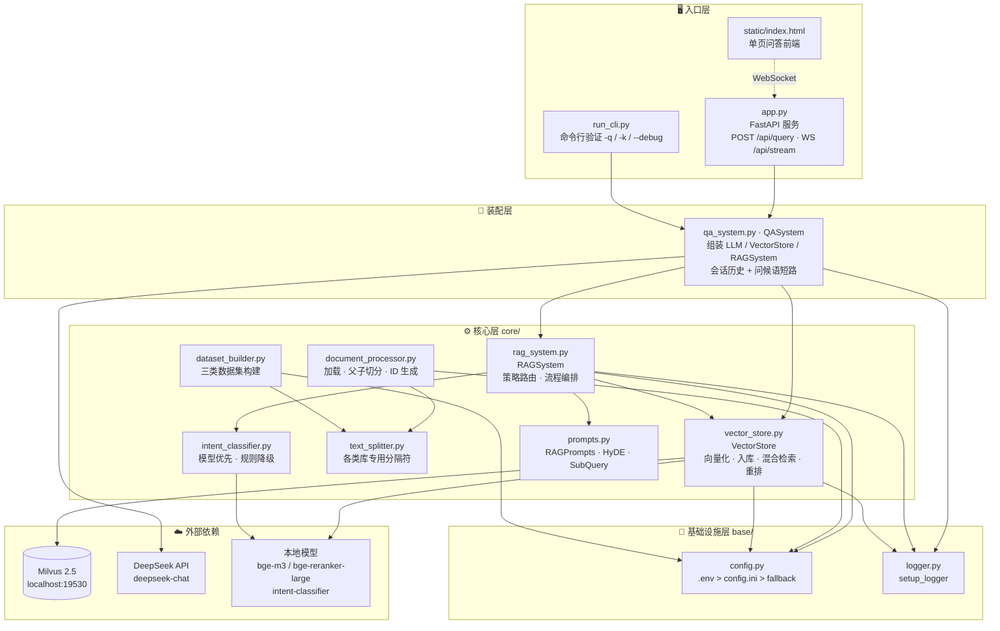
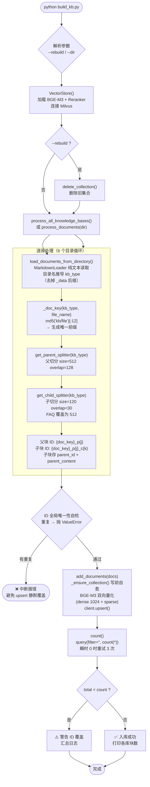
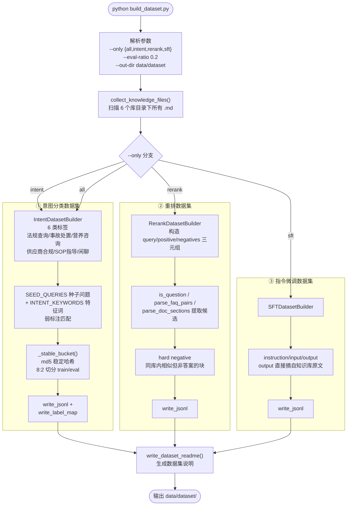
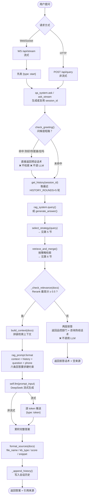
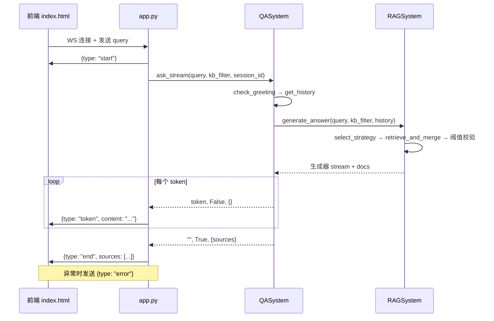
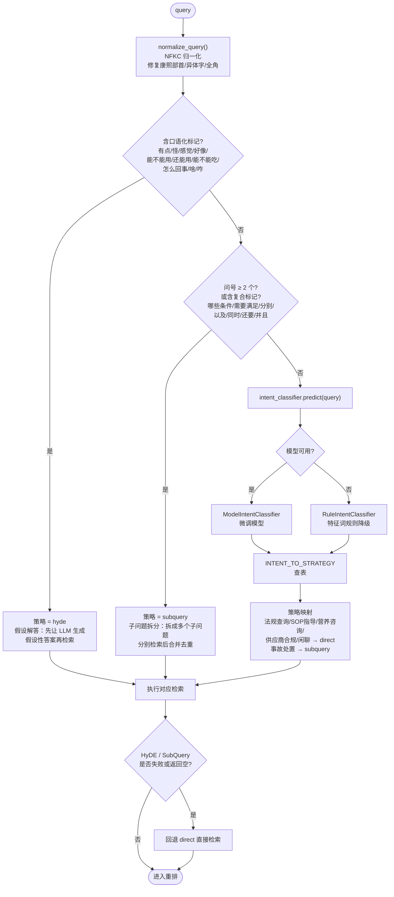
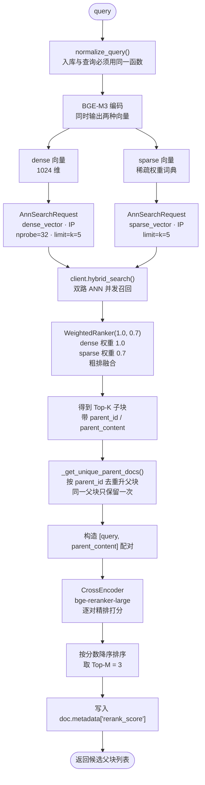
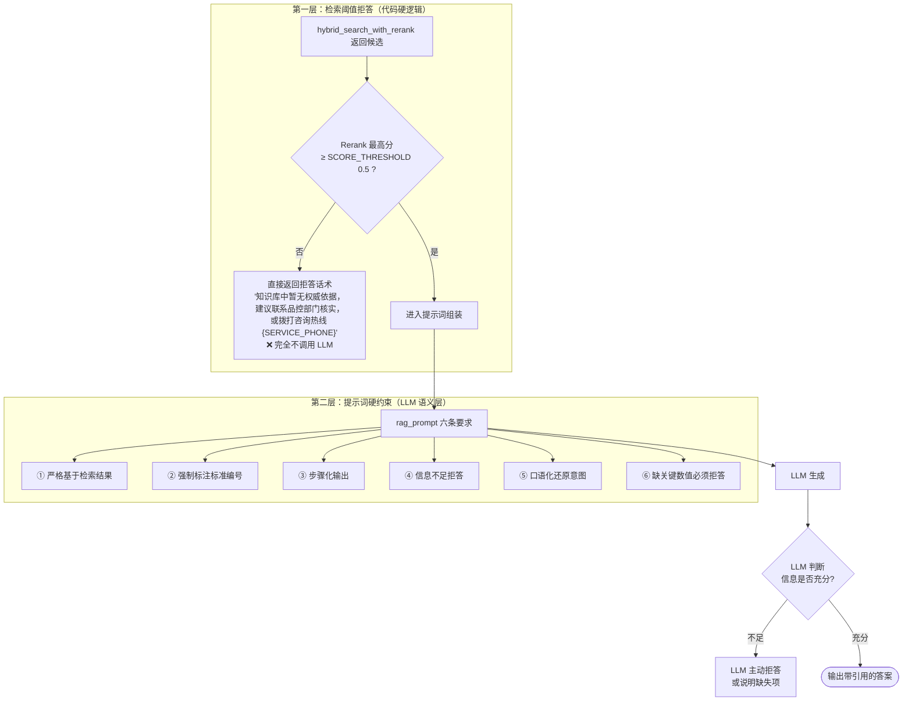
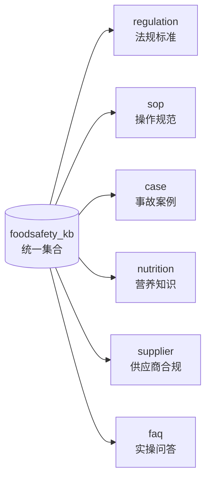

# 食品安全知识库系统 — 流程图总览

> 依据 `D:/heima/FoodSafetySystem` 源码梳理，覆盖 **系统分层**、**离线建库**、**离线数据集构建**、**在线问答** 四条主线。
> 所有图使用 Mermaid 语法，可在支持 Mermaid 的 Markdown 阅读器（Typora / VS Code / GitHub / 语雀）中直接渲染。

---

## 目录

- [0. 系统全貌](#0-系统全貌)
- [1. 系统分层与模块依赖](#1-系统分层与模块依赖)
- [2. 离线建库流程](#2-离线建库流程)
- [3. 离线训练数据集构建流程](#3-离线训练数据集构建流程)
- [4. 在线问答主流程](#4-在线问答主流程)
- [5. 检索策略路由详解](#5-检索策略路由详解)
- [6. 混合检索 + 重排详解](#6-混合检索--重排详解)
- [7. 两层拒答防线](#7-两层拒答防线)
- [8. 数据模型与 Milvus Schema](#8-数据模型与-milvus-schema)

---

## 0. 系统全貌

系统由 **三条独立链路** 组成，共用同一份 `data/*.md` 知识库原文与同一套 `core/` 模块：

**三条链路的关系：**

| 链路 | 触发方式 | 产物 | 是否调用 LLM |
|---|---|---|---|
| ① 离线建库 | `python build_kb.py` | Milvus 集合 `foodsafety_kb` | ❌ 只用 Embedding 模型 |
| ② 离线数据集 | `python build_dataset.py` | `data/dataset/{intent,rerank,sft}/` | ❌ 纯规则 + 原文摘录 |
| ③ 在线问答 | 启动 `app.py` 后请求接口 | 答案 + 引用来源 | ✅ DeepSeek |

---

## 1. 系统分层与模块依赖

**依赖方向：** 入口层 → 装配层 → 核心层 → 基础设施层 → 外部依赖。
核心层各模块之间只有 `rag_system` 依赖 `vector_store` / `intent_classifier` / `prompts`，其余互不依赖，**无循环引用**。

---

## 2. 离线建库流程

对应脚本 `build_kb.py`，核心函数链：`VectorStore()` → `delete_collection()`（可选）→ `process_all_knowledge_bases()` → `add_documents()` → `count()`。

**关键设计点：**

- **父子两级切分**：父块（512 字）保证上下文完整，子块（120 字）保证检索精度；命中子块后用 `parent_content` 还原父块送 LLM。
- **ID 唯一性**：用 `md5(kb_type/file_name)[:12]` 做前缀，杜绝早期「222 个子块只剩 93 个唯一 ID」的撞车问题。
- **写库幂等**：用 `upsert` 而非 `insert`，同一份文档重复构建不会产生重复数据。
- **FAQ 特例**：`FAQ_SEPARATORS` 只按 `\nQ[:：]` / `\n问[:：]` 切分（不能把 `A/答` 当分隔符，否则切出「只有问题没答案」的残块）；`CHILD_CHUNK_SIZE_OVERRIDE = {'faq': 512}` 放大 FAQ 子块。

---

## 3. 离线训练数据集构建流程

对应脚本 `build_dataset.py` + `core/dataset_builder.py`，**全程不调用 LLM**，靠规则 + 原文摘录。

**稳定哈希的意义**：`_stable_bucket` 用 `md5` 而非 Python 内置 `hash()`，避免 `PYTHONHASHSEED` 每次运行不同导致 train/eval 划分漂移、评估集泄漏。

---

## 4. 在线问答主流程

对应 `app.py` → `qa_system.py` → `core/rag_system.py` → `core/vector_store.py`。

**接口清单：**

| 方法 | 路径 | 说明 |
|---|---|---|
| GET | `/` | 返回 `static/index.html` |
| GET | `/health` | 健康检查 |
| GET | `/api/kb_types` | 返回 6 大知识库选项 |
| POST | `/api/create_session` | 创建会话 ID |
| GET | `/api/history/{session_id}` | 读取会话历史 |
| DELETE | `/api/history/{session_id}` | 清空会话历史 |
| POST | `/api/query` | 非流式问答 |
| WS | `/api/stream` | 流式问答（start / token / end / error） |

**WebSocket 消息类型：**

---

## 5. 检索策略路由详解

`RAGSystem.select_strategy()` 的**路由优先级：形态判断 → 意图分类**。这是本项目最容易误解的一点：**先看句式形态，再看语义意图**。

**三种策略对比：**

| 策略 | 触发条件 | 做法 | 失败兜底 |
|---|---|---|---|
| `direct` | 默认 / 大部分意图 | 直接用原 query 检索 | — |
| `hyde` | 含口语化标记 | LLM 先生成假设性答案，用假设答案检索 | 回退 direct |
| `subquery` | 多问号 / 复合标记 / 事故处置意图 | 拆成多个子问题分别检索，按 `page_content` 去重合并 | 回退 direct |

**意图 → 策略映射表（`INTENT_TO_STRATEGY`）：**

| 意图 | 策略 |
|---|---|
| 法规查询 | direct |
| SOP 指导 | direct |
| 营养咨询 | direct |
| 供应商合规 | direct |
| 闲聊 | direct |
| **事故处置** | **subquery** |

---

## 6. 混合检索 + 重排详解

对应 `core/vector_store.py` 的 `hybrid_search_with_rerank()`。核心思想：**双路召回 → 粗排融合 → 子块升父块 → 精排截断**。

**参数说明：**

| 参数 | 值 | 位置 | 含义 |
|---|---|---|---|
| `PARENT_CHUNK_SIZE` | 512 | config | 父块大小 |
| `CHILD_CHUNK_SIZE` | 120 | config | 子块大小（FAQ 覆盖为 512） |
| `RETRIEVAL_K` | 5 | config | 每路 ANN 召回数 |
| `CANDIDATE_M` | 3 | config | 重排后保留父块数 |
| `SCORE_THRESHOLD` | 0.5 | config | 拒答阈值 |
| `NPROBE` | 32 | config | IVF_FLAT 探查簇数（nlist=128，约 1/4） |
| `WeightedRanker` | (1.0, 0.7) | 代码 | dense / sparse 融合权重 |

**为什么要有 `WeightedRanker` 这一步：** dense 向量擅长语义相似（「冷链温度」≈「冷藏要求」），sparse 向量擅长关键词精确命中（标准编号 `GB 31605-2020`）。两者分数尺度不同，必须先融合成统一排序，再做 CrossEncoder 精排。

---

## 7. 两层拒答防线

用户明确要求「不编造、缺依据就拒答」，系统用**两层**保证：

| 防线 | 位置 | 触发方式 | 优点 | 局限 |
|---|---|---|---|---|
| 第一层 | `_check_relevance()` | 代码判断分数 | 确定性高、省 token | 只能判断「有没有」，不能判断「够不够」 |
| 第二层 | `core/prompts.py` 第 4、6 条 | LLM 语义理解 | 能识别「答非所问」「缺具体数值」 | 依赖模型遵循指令的能力 |

**两层互补**：第一层拦掉「知识库里根本没有的问题」，第二层拦掉「有相关内容但不足以回答的问题」（例如只说了要留样、但没给留样时间和温度）。

---

## 8. 数据模型与 Milvus Schema

**统一 Collection：`foodsafety_kb`**（Milvus 2.5，database=`foodsafety`）

| 字段 | 类型 | 说明 |
|---|---|---|
| `id` | VARCHAR(100) | 主键，`{doc_key}_p{j}_c{k}` |
| `text` | VARCHAR(65535) | 子块文本（用于检索命中） |
| `dense_vector` | FLOAT_VECTOR(1024) | BGE-M3 dense 向量 |
| `sparse_vector` | SPARSE_FLOAT_VECTOR | BGE-M3 sparse 向量 |
| `parent_id` | VARCHAR | 指向父块 |
| `parent_content` | VARCHAR(65535) | 父块全文（送 LLM 用） |
| `kb_type` | VARCHAR | 6 大知识库标量过滤字段 |
| `file_name` | VARCHAR | 来源文件 |
| `timestamp` | INT64 | 写入时间 |

**索引：**

| 索引 | 字段 | 类型 | 度量 | 参数 |
|---|---|---|---|---|
| `dense_index` | dense_vector | IVF_FLAT | IP | `nlist=128` |
| `sparse_index` | sparse_vector | SPARSE_INVERTED_INDEX | IP | `drop_ratio_build=0.2` |

**6 大知识库（`kb_type` → 目录 → 中文名）：**

**统一 Collection 的好处：** 一次检索可跨库召回（`kb_filter=None`），也可用 `expr="kb_type == 'regulation'"` 精确过滤到单库——对应前端知识库下拉框。

---

## 附：核心源码文件索引

| 文件 | 职责 |
|---|---|
| `app.py` | FastAPI 服务入口，挂载静态页，HTTP + WebSocket 接口 |
| `qa_system.py` | 装配层，会话历史管理，问候语短路，LLM 异常兜底 |
| `run_cli.py` | 命令行验证工具 |
| `core/rag_system.py` | RAG 主流程编排，策略路由，拒答判断 |
| `core/vector_store.py` | 向量化、入库、混合检索、重排 |
| `core/document_processor.py` | 文档加载、父子切分、ID 生成与自检 |
| `core/text_splitter.py` | 各库专用分隔符与切分器 |
| `core/intent_classifier.py` | 意图识别（模型优先，规则降级） |
| `core/prompts.py` | RAG / HyDE / SubQuery 三类提示词 |
| `core/dataset_builder.py` | 意图 / 重排 / SFT 三类数据集构建 |
| `base/config.py` | 配置加载（.env > config.ini > fallback） |
| `base/logger.py` | 日志配置 |
| `build_kb.py` | 离线建库脚本（支持 `--rebuild`） |
| `build_dataset.py` | 离线数据集构建脚本 |
| `static/index.html` | 单页问答前端 |
